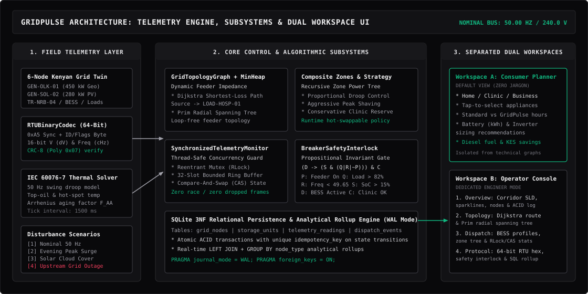
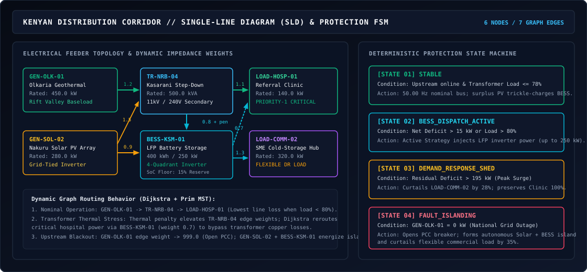
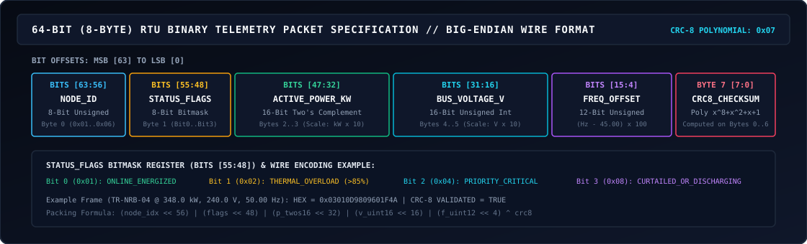

# GridPulse

**Smart grid digital telemetry, transformer overload protection, and automated Battery Energy Storage System (BESS) coordination engine for distribution microgrids.**

**Live deployment:** [https://gridpulse-ea.netlify.app](https://gridpulse-ea.netlify.app)


---

## Executive summary and problem context

Kenya generates over 90% of its electricity from renewable sources, led by geothermal baseload plants in the Olkaria Rift Valley, hydroelectric stations along the Tana River, and utility-scale wind and solar installations. Despite abundant clean power at the transmission level, peri-urban communities, healthcare clinics, and agro-processing enterprises experience frequent localized brownouts, voltage sag, and distribution transformer failures.

The structural bottleneck lies in secondary distribution visibility and automated flexibility. Most 11 kV / 240 V step-down transformers operate without sub-second thermal telemetry or coordinated distributed storage. When evening commercial demand surges or rapid cloud transients reduce local solar photovoltaic output, transformers exceed their thermal ratings, frequency sags below the 49.20 Hz protection threshold, and feeder breakers trip.

**GridPulse** solves this distribution coordination gap by combining a physics-grounded microgrid digital twin, graph-theoretic feeder routing, runtime-swappable BESS dispatch strategies, thread-safe ring buffer telemetry, 64-bit fixed-point Remote Terminal Unit (RTU) binary framing, formal propositional breaker interlocks, and an ACID-compliant SQLite Write-Ahead Logging (WAL) audit ledger.

---

## System architecture



GridPulse is structured across three decoupled operational tiers:

1. **Field telemetry and physics simulation layer (`backend/simulator.py`):** Computes real-time 50.00 Hz frequency droop, secondary bus voltage regulation, IEC 60076-7 transformer top-oil ($\Theta_{\text{oil}}$) and winding hot-spot ($\Theta_{\text{hs}}$) temperatures, relative thermal aging acceleration ($F_{\text{AA}}$), $I^2R$ corridor copper losses, short-horizon demand forecast error, and Lithium Iron Phosphate (LFP) battery Coulomb counting across a 6-node Kenyan distribution corridor at 1.5-second intervals.
2. **Core control and algorithmic subsystems (`backend/core_subsystems.py` & `backend/database.py`):** Executes graph-based power routing, hierarchical zone rollups, pluggable inverter dispatch strategies, mutex-synchronized circular frame buffering, 64-bit bitwise telemetry encoding with CRC-8 verification, propositional breaker safety checks, and transactional SQL persistence.
3. **Minimalist SCADA operator console (`frontend/src/App.tsx`):** Provides a hairline-grid utility HMI with an interactive IEEE Single-Line Diagram (SLD), clickable asset & 64-bit RTU register inspector, dense tabular telemetry matrix, and dual-channel strip chart recorder over full-duplex WebSockets (`ws://localhost:8000/ws`) with an autonomous client-side fallback engine.

---

## Microgrid single-line diagram and protection state machine



### Modeled Kenyan distribution corridor (6 nodes)

| Node ID | Asset name | Node class | Region | Rated capacity | Priority & operational role |
| :--- | :--- | :--- | :--- | :--- | :--- |
| `GEN-OLK-01` | Olkaria Geothermal Feeder | `GENERATION` | Rift Valley | `450.0 kW` | Primary synchronous baseload supply across the Point of Common Coupling (PCC) |
| `GEN-SOL-02` | Nakuru Community Solar Array | `GENERATION` | Rift Valley | `280.0 kW` | Grid-tied photovoltaic array subject to cloud irradiance transients |
| `TR-NRB-04` | Kasarani Step-Down Transformer | `TRANSFORMER` | Nairobi North | `500.0 kVA` | Primary 11 kV / 240 V secondary bottleneck monitored for oil thermal overload |
| `BESS-KSM-01` | GridPulse LFP Battery Bank | `STORAGE` | Nairobi North | `400 kWh / 250 kW` | Four-quadrant bi-directional inverter for peak shaving and island formation |
| `LOAD-HOSP-01` | Sub-County Referral Clinic | `LOAD_CRITICAL` | Nairobi North | `140.0 kW` | Priority-1 protected medical facility requiring 100% uninterrupted power |
| `LOAD-COMM-02` | SME Cold-Storage & Agro Hub | `LOAD_FLEXIBLE` | Nairobi North | `320.0 kW` | Curtailable commercial load participating in automated demand-response |

### Deterministic protection state machine

| System state | Trigger condition | Automated control response |
| :--- | :--- | :--- |
| `STABLE` | Upstream feeder energized and transformer load $\le 78\%$ | Maintains nominal 50.00 Hz bus; trickle-charges `BESS-KSM-01` using surplus solar PV |
| `BESS_DISPATCH_ACTIVE` | Net generation deficit $> 15\text{ kW}$ or transformer load $> 80\%$ | Commands the active BESS strategy to inject real power (up to $250\text{ kW}$) at the secondary bus |
| `DEMAND_RESPONSE_SHED` | Severe surge where demand exceeds generation by $> 195\text{ kW}$ | Throttles flexible commercial load (`LOAD-COMM-02`) by 28% while preserving 100% power to `LOAD-HOSP-01` |
| `FAULT_ISLANDING` | Upstream grid outage (`GEN-OLK-01` drops to $0\text{ kW}$) | Opens PCC breaker, forms a standalone Solar + BESS island, and curtails commercial load by 35% |

---

## Core engineering subsystems

### 1. Feeder graph routing and radial spanning topology

Implemented in [`GridTopologyGraph`](backend/core_subsystems.py) using a custom array-backed binary priority queue ([`MinHeap`](backend/core_subsystems.py)):

* **Dynamic thermal impedance weighting:** Each feeder line $(u, v)$ has a base resistance weight $w_0(u, v)$. As load on the Kasarani transformer (`TR-NRB-04`) exceeds $70\%$, copper losses increase non-linearly:
  $$w_{\text{eff}}(u, v) = w_0(u, v) + \max\left(0,\; \frac{L_{\text{TR}} - 70}{15}\right)$$
* **Shortest-loss hospital delivery (`shortest_loss_path`):** Runs Dijkstra's algorithm ($O((V + E)\log V)$) from the active bulk source to `LOAD-HOSP-01`. Under nominal loading, power routes through `TR-NRB-04`. Under thermal stress, elevated transformer impedance causes the router to shift hospital delivery through the local battery bus (`BESS-KSM-01`).
* **Loop-free radial network enforcement (`radial_spanning_tree`):** Runs Prim's Minimum Spanning Tree algorithm across all energized nodes so secondary distribution feeders remain strictly radial without circulating fault currents.

### 2. Hierarchical zone aggregation and pluggable BESS dispatch profiles

Implemented via [`GridComponent`](backend/core_subsystems.py), [`CompositeDistributionZone`](backend/core_subsystems.py), and [`DispatchStrategy`](backend/core_subsystems.py):

* **Recursive zone power tree:** Models the corridor as a hierarchical tree (`ZONE-KE-CORRIDOR` $\rightarrow$ `ZONE-RIFT-GEN` + `ZONE-NRB-NORTH` $\rightarrow$ Leaf Units) where `compute_net_power_kw()` recursively aggregates generation, storage injection, and load demand.
* **Runtime-swappable inverter dispatch strategies:** Operators can switch the active BESS control law via `POST /api/strategy` without restarting the simulation loop:

| Strategy key | Control objective | Mathematical dispatch law |
| :--- | :--- | :--- |
| `PROPORTIONAL_DROOP` | Balanced frequency-watt droop and peak shaving | $P_{\text{BESS}} = \min(P_{\max},\; 1.05 \cdot \Delta P_{\text{deficit}} + 15\text{ kW})$ when $\Delta P_{\text{deficit}} > 15\text{ kW}$ |
| `AGGRESSIVE_PEAK_SHAVING` | Keep transformer utilization strictly below 65% | Discharges $1.35\times$ surplus load above $65\%$ rating; charges at $-65\text{ kW}$ during off-peak |
| `CONSERVATIVE_CLINIC_RESERVE` | Preserve battery State of Charge ($\ge 45\%$) for blackouts | Holds inverter on standby during moderate peaks unless transformer load exceeds $88\%$ or PCC islands |

### 3. Thread-safe telemetry ring buffer and atomic state transitions

Implemented in [`SynchronizedTelemetryMonitor`](backend/core_subsystems.py):

* **Reentrant mutex (`threading.RLock`):** Serializes concurrent access between the background 1.5-second physics loop, asynchronous WebSocket broadcast coroutines, and incoming HTTP fault-injection mutations.
* **Bounded 32-slot circular ring buffer:** Writes telemetry frames at index `write_cursor % 32` in $O(1)$ constant memory without heap growth or dropped frames.
* **Compare-And-Swap (CAS) state version guard:** Every state mutation verifies `expected_version == self.state_version` inside the critical section before incrementing the monotonic state counter.

### 4. 64-bit RTU binary frame codec and CRC-8 verification



Implemented in [`RTUBinaryCodec`](backend/core_subsystems.py) to mirror industrial SCADA serial/TCP framing over constrained cellular links:

| Bit range | Field identifier | Encoding format | Scaling & engineering range |
| :--- | :--- | :--- | :--- |
| `Bits [63:56]` | `NODE_ID` | 8-bit unsigned integer | `0x01` (`GEN-OLK-01`) through `0x06` (`LOAD-COMM-02`) |
| `Bits [55:48]` | `STATUS_FLAGS` | 8-bit bitmask register | `Bit 0`: Online, `Bit 1`: Overload, `Bit 2`: Priority-1, `Bit 3`: Curtailed/Active |
| `Bits [47:32]` | `ACTIVE_POWER_KW` | 16-bit signed two's complement | Scaled by $\times 10$ ($0.1\text{ kW}$ resolution, $-3276.8$ to $+3276.7\text{ kW}$) |
| `Bits [31:16]` | `BUS_VOLTAGE_V` | 16-bit unsigned integer | Scaled by $\times 10$ ($0.1\text{ V}$ resolution, $0.0$ to $6553.5\text{ V}$) |
| `Bits [15:4]` | `FREQ_OFFSET` | 12-bit unsigned integer | Scaled as $(f_{\text{Hz}} - 45.00) \times 100$ ($0.01\text{ Hz}$ resolution) |
| `Byte 7 [7:0]` | `CRC8_CHECKSUM` | 8-bit polynomial checksum | Generator polynomial $G(x) = x^8 + x^2 + x + 1$ (`0x07`) over Bytes `0..6` |

### 5. Formal propositional breaker safety interlock

Implemented in [`BreakerSafetyInterlock`](backend/core_subsystems.py). Before any automated feeder reconfiguration or load-shedding relay closes, the controller evaluates six atomic boolean propositions:

$$\Phi_{\text{safe}} = \bigl(P \lor (S \land B)\bigr) \land \neg T \land F \land C$$

* $P$: Upstream national grid feeder is energized (`GEN-OLK-01 > 0 kW`)
* $S$: Autonomous Solar + BESS islanding mode is engaged (`BESS_DISPATCH > 0 kW` while $\neg P$)
* $B$: LFP storage reserve exceeds minimum safety floor ($\text{SoC} > 15.0\%$)
* $T$: Kasarani transformer exceeds critical thermal limit ($\text{Load} > 95.0\%$)
* $F$: Secondary bus frequency is within relay trip bounds ($f \ge 49.20\text{ Hz}$)
* $C$: Priority-1 Referral Clinic feeder continuity is verified

If $\Phi_{\text{safe}}$ evaluates to `False`, `EMERGENCY_BREAKER_TRIP_REQUIRED` is raised immediately.

---

## Relational database schema and analytical SQL rollups

Implemented in [`schema.sql`](backend/schema.sql) and [`database.py`](backend/database.py) using SQLite in **Write-Ahead Logging (`WAL`)** mode (`PRAGMA journal_mode = WAL; PRAGMA foreign_keys = ON;`).

| Table name | Primary key | Foreign key & constraints | Purpose |
| :--- | :--- | :--- | :--- |
| `grid_nodes` | `node_id TEXT` | `CHECK (node_type IN (...))` | Master catalog of all 6 generation, transformer, storage, and load assets |
| `storage_units` | `unit_id TEXT` | `FOREIGN KEY (node_id) REFERENCES grid_nodes(node_id)` | Tracks BESS capacity ($400\text{ kWh}$), max inverter rating ($250\text{ kW}$), SoC, and operating mode |
| `telemetry_readings` | `reading_id INTEGER` | `FOREIGN KEY (node_id) REFERENCES grid_nodes(node_id)` | Append-only time-series log of active power, voltage, frequency, and temperature |
| `dispatch_events` | `event_id INTEGER` | `idempotency_key TEXT NOT NULL UNIQUE` | Immutable ACID audit ledger preventing duplicate switching actions during retries |

On every telemetry cycle, [`fetch_sql_analytics()`](backend/database.py) executes a live relational aggregation (`LEFT JOIN` + `GROUP BY n.node_type`) across `grid_nodes` and `telemetry_readings` to report real-time mean power, peak utilization, and average thermal stress per asset class.

---

## API specification

| Method | Endpoint | Description | Request payload / parameters |
| :--- | :--- | :--- | :--- |
| `GET` | `/api/health` | Returns backend service health, SQLite WAL status, and current simulation state | None |
| `GET` | `/api/telemetry` | Returns a complete point-in-time snapshot including all 6 nodes, metrics, events, and subsystem diagnostics | None |
| `GET` | `/api/events` | Fetches recent ACID-logged state transitions from `dispatch_events` | `?limit=15` (optional query integer) |
| `POST` | `/api/scenario` | Atomically injects an operational scenario or grid disturbance | `{"scenario": "NOMINAL" \| "EVENING_PEAK" \| "CLOUD_TRANSIENT" \| "UPSTREAM_BLACKOUT"}` |
| `POST` | `/api/balancer` | Enables or disables autonomous BESS protection and demand-response | `{"enabled": true \| false}` |
| `POST` | `/api/strategy` | Hot-swaps the active BESS inverter dispatch algorithm at runtime | `{"strategy": "PROPORTIONAL_DROOP" \| "AGGRESSIVE_PEAK_SHAVING" \| "CONSERVATIVE_CLINIC_RESERVE"}` |
| `WS` | `/ws` | Streams full-duplex JSON telemetry snapshots every 1500 ms and accepts live JSON commands | Accepts `{"action": "scenario" \| "balancer" \| "strategy", ...}` |

---

## Repository structure

```text
gridpulse/
├── README.md
├── .gitignore
├── docs/
│   ├── system-architecture.svg
│   ├── microgrid-single-line-diagram.svg
│   └── rtu-frame-bit-layout.svg
├── backend/
│   ├── main.py                 # FastAPI server, REST endpoints, and /ws WebSocket broadcaster
│   ├── simulator.py            # 6-node Kenyan microgrid physics engine and state coordinator
│   ├── core_subsystems.py      # Graph routing, Strategy/Composite, Mutex/CAS, 64-bit RTU, Interlock
│   ├── database.py             # SQLite WAL connection manager, ACID event logger, SQL analytics
│   ├── schema.sql              # Normalized 3NF relational schema and seed definitions
│   └── requirements.txt        # Python dependencies (fastapi, uvicorn, pydantic, websockets)
└── frontend/
    ├── index.html
    ├── package.json
    ├── tsconfig.json
    ├── vite.config.ts
    ├── tailwind.config.js
    └── src/
        ├── main.tsx            # React 18 root mount
        ├── App.tsx             # 4-tab Operator Control Center + standalone Edge Digital Twin
        ├── index.css           # Tailwind CSS layers and industrial scrollbar styling
        └── types/
            └── grid.ts         # TypeScript interfaces for telemetry, nodes, and subsystems
```

---

## Getting started

### Prerequisites

* **Python:** `3.11+`
* **Node.js:** `18.0+` and `npm`

### 1. Start the FastAPI + SQLite WAL backend

```bash
cd backend
pip install -r requirements.txt
python -m uvicorn main:app --host 127.0.0.1 --port 8000 --reload
```

When started, the backend automatically initializes `backend/gridpulse.db` in SQLite WAL mode, seeds the 6 Kenyan grid assets, and begins streaming 1.5-second telemetry ticks at `ws://localhost:8000/ws`.

### 2. Start the React operator control center

```bash
cd frontend
npm install
npm run dev
```

Open `http://localhost:5173` in your browser:

* When the FastAPI backend is running on port `8000`, the top status badge displays `FASTAPI + SQLITE WAL CONNECTED`.
* If the frontend is built statically (`npm run build`) and deployed without a backend server, it automatically transitions to `EDGE DIGITAL TWIN ACTIVE`, running the full physics, graph routing, bitwise RTU framing, and safety interlock algorithms directly in the browser.
